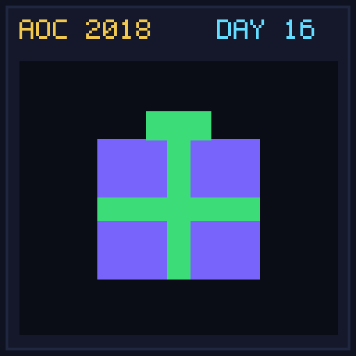

[< Day 15](../day15/README.md) | [AoC 2018](../README.md) | [Day 17 >](../day17/README.md)

[View Problem on Advent of Code](https://adventofcode.com/2018/day/16)

## Setup

Model the wrist device's four-register CPU and its 16 operations (`addr`, `addi`, `mulr`, `muli`, `banr`, `bani`, `borr`, `bori`, `setr`, `seti`, `gtir`, `gtri`, `gtrr`, `eqir`, `eqri`, `eqrr`), then deduce the numeric opcode mapping from captured register state samples.

## Solution

### Part 1

Parse each `Before` / instruction / `After` sample and count how many samples match three or more of the 16 candidate operations.

### Part 2

Use constraint elimination across all samples to uniquely resolve each numeric opcode (`0..15`) to its corresponding `Operation`, then execute the test program starting from `[0, 0, 0, 0]` to find the final value in register `0`.

## Performance

| Part | Runtime |
|:---:|:---:|
| Part 1 | 7.0ms |
| Part 2 | 7.0ms |
| **Total** | **14ms** |

