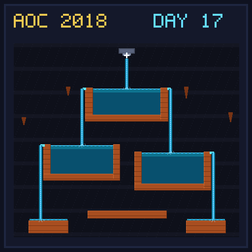

[< Day 16](../day16/README.md) | [AoC 2018](../README.md) | [Day 18 >](../day18/README.md)

[View Problem on Advent of Code](https://adventofcode.com/2018/day/17)

## Setup

Simulate water flowing downward and spreading horizontally from an underground spring (`x=500, y=0`) through sand and clay basins based on 2D ground scan coordinates.

## Solution

### Part 1

Parse the horizontal and vertical clay veins and simulate water flow using a queue of active flow heads, tracking both flowing (`|`) and settled (`~`) water tiles within the vertical bounds of the scan.

### Part 2

Determine how many water tiles remain after the spring stops producing water and all flowing water (`|`) drains away, counting only settled water (`~`) retained inside clay reservoirs.

## Performance

| Part | Runtime |
|:---:|:---:|
| Part 1 | 48ms |
| Part 2 | 24ms |
| **Total** | **72ms** |

